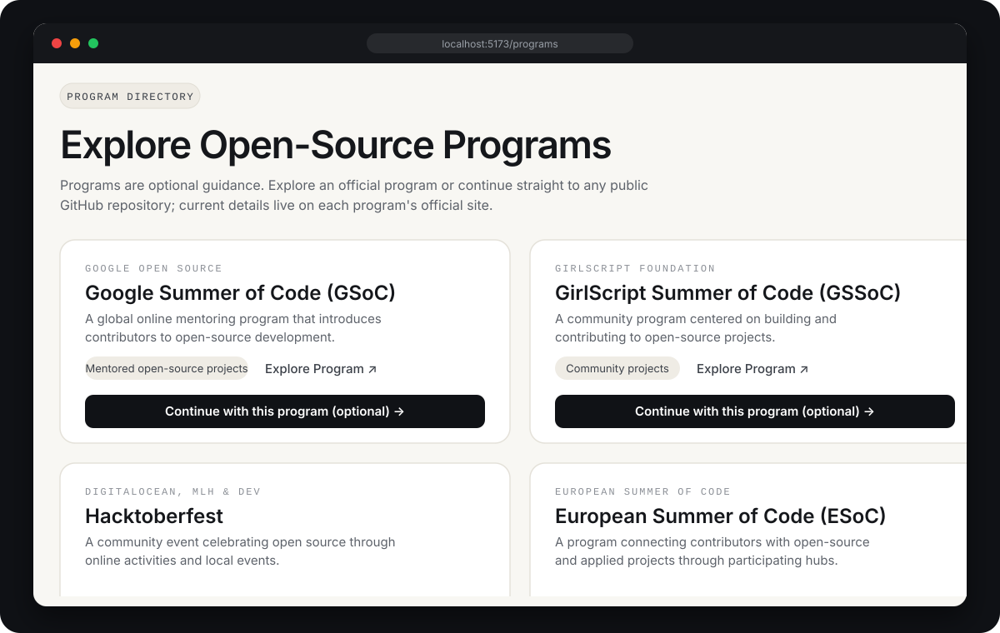
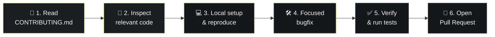
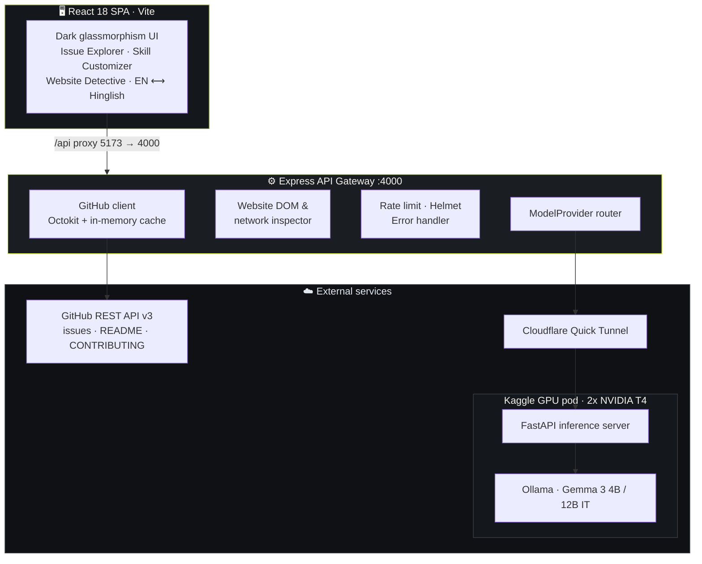
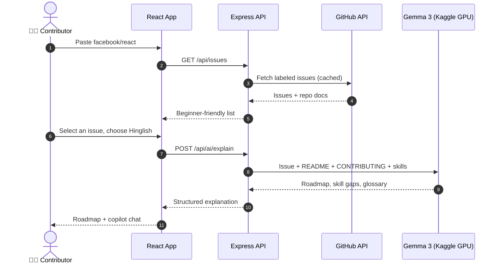
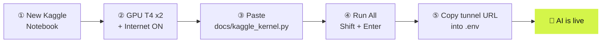
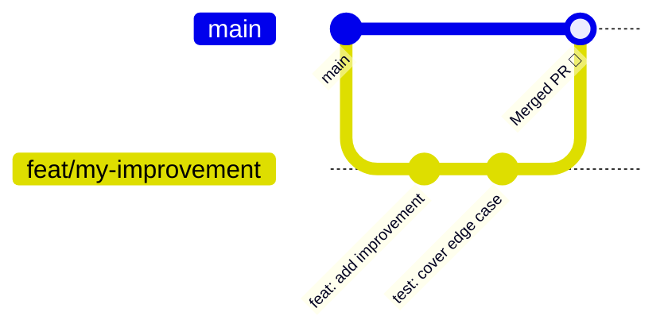

<div align="center">



<br/>

<a href="https://git.io/typing-svg"></a>

<br/><br/>

[](https://opensource.org/licenses/MIT)
[](https://reactjs.org/)
[](https://vitejs.dev/)
[](https://expressjs.com/)
[](https://ai.google.dev/gemma)
[](https://www.kaggle.com/)
[](https://www.cloudflare.com/)

[](#-contributing)
[](https://github.com/bytebymanas/first-commit/issues)
[](https://github.com/bytebymanas/first-commit/stargazers)
[](https://github.com/bytebymanas/first-commit/network/members)
[](https://github.com/bytebymanas/first-commit/commits)

<h3>An AI pair-programmer that takes you from "where do I even start?" to a merged pull request.</h3>

**[✨ Features](#-features)** &nbsp;•&nbsp; **[🖼️ Preview](#️-preview)** &nbsp;•&nbsp; **[🧠 Architecture](#-architecture)** &nbsp;•&nbsp; **[⚡ Free GPU](#-free-cloud-gpu-kaggle--gemma-3)** &nbsp;•&nbsp; **[🛠️ Quick Start](#️-quick-start)** &nbsp;•&nbsp; **[📖 API](#-api-reference)** &nbsp;•&nbsp; **[🤝 Contribute](#-contributing)**

</div>


## 🖼️ Preview

Three paths from the home screen: **Find my first issue**, **Explore programs** and **Inspect a website**.


<div align="center">
  
  <br/>
  <sub>The Program Directory: explore GSoC, GSSoC, Hacktoberfest and ESoC, or skip straight to any public GitHub repo. Programs are optional guidance.</sub>
</div>

<br/>

## 🎯 Why FirstCommit?

Most beginners never make a first contribution. Not because they can't code, but because the entry barrier is mostly *context*.

| 🛑 The barrier | 🚀 How FirstCommit removes it |
|:---|:---|
| **Cryptic jargon** — *"Rehydrate mutex on state mutation"* | **Plain-language summaries** with a built-in technical glossary |
| **Imposter syndrome** — *"Is this too hard for me?"* | **Skill-gap matrix** that shows what you already know and what you'll learn |
| **Language barrier** — issues are written in dense technical English | **English ⟷ Hinglish toggle** for friendly, conversational breakdowns |
| **"Which program should I join?"** — too many options | **Program Directory** with official links, always optional |
| **"Where do I find issues?"** — GitHub search is tedious | **Website Issue Detective** scans a live site and drafts a ready-to-file bug report |
| **Expensive LLM APIs** — student budgets are tight | **Gemma 3 on free Kaggle GPUs**, no API fees, no credit card |


## ✨ Features

<table>
<tr>
<td width="50%" valign="top">

### 🧭 Program Directory
Explore **GSoC, GSSoC, Hacktoberfest and ESoC** with links to each official site, then continue with a program or go straight to any public GitHub repo. Programs are always optional.

### 🔍 Repository & Issue Explorer
Paste a full URL or just `owner/repo`. Beginner labels (`good first issue`, `beginner`, `help wanted`, `documentation`) are prioritized automatically.

One-click presets: `react` · `freeCodeCamp` · `cal.com` · `tldraw` · `shadcn/ui`

</td>
<td width="50%" valign="top">

### 🕵️ Website Issue Detective
Enter any public site URL and FirstCommit audits it for:

♿ **Accessibility** — alt text, contrast, tab focus
📱 **Responsive** — overflow, tap targets
⚡ **SEO & performance** — meta tags, headers

…then drafts a **complete GitHub issue** with repro steps, expected vs. actual behavior and a severity rating.

</td>
</tr>
<tr>
<td width="50%" valign="top">

### 🇮🇳 Bilingual AI (English + Hinglish)
Flip one switch and the explanation becomes friendly and conversational:

> *"Bhai, is issue mein login button ka click handler refactor ke time remove ho gaya tha. Tujhe `src/auth/login.js` mein listener wapas add karna hai, tests run karne hain, aur clean PR open karni hai. Chill scene hai! 🚀"*

</td>
<td width="50%" valign="top">

### 🤖 Context-Aware Copilot
A floating chat that already knows the issue you're viewing:

- *"How do I run tests for this file?"*
- *"What should I ask the maintainer before opening a PR?"*
- *"What does this stack trace mean?"*

</td>
</tr>
</table>

### 🗺️ The 6-Step Contribution Roadmap

Every issue is converted into a concrete checklist:



<details>
<summary><b>👉 Click to see what each step gives you</b></summary>

<br/>

| Step | What you get |
|:--:|:--|
| **1. Read the guide** | Direct link to the repo's `CONTRIBUTING.md` |
| **2. Inspect code** | Suggested files and code references |
| **3. Local setup** | Exact commands to run the project and reproduce the bug |
| **4. Focused bugfix** | Guidance for a minimal, clean change |
| **5. Verify** | How to run the test suite |
| **6. Pull request** | Branch naming, commit message and PR description templates |

</details>


## 🧠 Architecture



### How a request flows




## ⚡ Free Cloud GPU (Kaggle + Gemma 3)

No expensive local GPU and no API subscription. FirstCommit runs **Google Gemma 3** on Kaggle's free dual **NVIDIA T4** GPUs, with about **~140 ms warm inference latency**.

| Resource | Spec |
|:--|:--|
| 🎮 GPUs | 2x NVIDIA T4 (about 30 GB VRAM total) |
| 🧠 Models | Gemma 3 4B IT and 12B IT via Ollama |
| 🌐 Tunnel | Cloudflare Quick Tunnel (no login, no token, no signup) |
| 💸 Cost | **$0** |



<details>
<summary><b>👉 Step-by-step GPU setup</b></summary>

<br/>

1. **Open a Kaggle notebook** at [kaggle.com/code](https://www.kaggle.com/code) and click **New Notebook**.
2. **Enable GPU and Internet** in the right sidebar:
   - **Accelerator** → `GPU T4 x2`
   - **Internet** → **On** (required to install Ollama and pull Gemma)
3. **Copy the kernel script.** Open [`docs/kaggle_kernel.py`](docs/kaggle_kernel.py), paste it into a notebook cell and run it.
4. **Copy your live tunnel URL** from the end of the output:
   ```text
   ============================================================
   ✅ First Commit Gemma Cloud GPU API is LIVE!
      URL: https://your-tunnel-name.trycloudflare.com
      Health check: https://your-tunnel-name.trycloudflare.com/health
   ============================================================
   ```
5. **Paste it into your local `.env`:**
   ```env
   AI_PROVIDER=kaggle
   KAGGLE_KERNEL_URL=https://your-tunnel-name.trycloudflare.com
   ```

> 💡 Quick Tunnels give you a new URL every time the notebook restarts, so update `KAGGLE_KERNEL_URL` when that happens.

</details>


## 🛠️ Quick Start

**Prerequisites:** Node.js `v20+` and pnpm `v10+` (or npm).

```bash
# 1. Clone and install
git clone https://github.com/bytebymanas/first-commit.git
cd first-commit
pnpm install

# 2. Configure environment
cp .env.example .env

# 3. Run client + server together
pnpm dev
```

Open **http://localhost:5173** 🎉

<details>
<summary><b>⚙️ Environment variables</b></summary>

<br/>

```env
PORT=4000
CLIENT_ORIGIN=http://localhost:5173

# AI provider: 'kaggle' (recommended) | 'huggingface'
AI_PROVIDER=kaggle
KAGGLE_KERNEL_URL=https://your-tunnel-url.trycloudflare.com

# Optional: raises GitHub API limit from 60 to 5,000 requests/hour
GITHUB_TOKEN=
```

| Variable | Required | Description |
|:--|:--:|:--|
| `PORT` | No | Express server port (default `4000`) |
| `CLIENT_ORIGIN` | No | Allowed CORS origin for the frontend |
| `AI_PROVIDER` | Yes | `kaggle` or `huggingface` |
| `KAGGLE_KERNEL_URL` | If `kaggle` | Your Cloudflare tunnel URL |
| `GITHUB_TOKEN` | No | Increases GitHub API rate limits |

</details>

### 💻 Scripts

| Command | Action |
|:--|:--|
| `pnpm dev` | Run client and server together with live reload |
| `pnpm dev:client` | Vite frontend only → `http://localhost:5173` |
| `pnpm dev:server` | Express backend only → `http://localhost:4000` |
| `pnpm build` | Production build for client and server |
| `pnpm typecheck` | Type-check all workspaces |


## 📖 API Reference

| Method | Endpoint | Description |
|:--:|:--|:--|
|  | `/api/health` | Server health and Kaggle GPU tunnel status |
|  | `/api/issues?owner=:owner&repo=:repo` | Open beginner issues with label filters |
|  | `/api/repositories/overview?owner=:owner&repo=:repo` | Repo stats, README preview and CONTRIBUTING guide |
|  | `/api/ai/explain` | Learning roadmap, skill readiness and glossary |
|  | `/api/ai/chat` | Contextual AI chat for issue Q&A |
|  | `/api/website-analysis` | Audit a live site for a11y, UX and bug opportunities |

<details>
<summary><b>👉 Try it with curl</b></summary>

<br/>

```bash
# Health check
curl http://localhost:4000/api/health

# Beginner issues for a repo
curl "http://localhost:4000/api/issues?owner=facebook&repo=react"
```

</details>


## 🤝 Contributing

FirstCommit exists to help you make your first contribution, so start right here.



1. **Fork** [bytebymanas/first-commit](https://github.com/bytebymanas/first-commit)
2. **Clone** your fork
   ```bash
   git clone https://github.com/<your-username>/first-commit.git
   cd first-commit
   ```
3. **Create a branch**
   ```bash
   git checkout -b feat/my-awesome-improvement
   ```
4. **Make changes and test** with `pnpm dev`
5. **Commit and push**
   ```bash
   git commit -m "feat: add awesome improvement"
   git push origin feat/my-awesome-improvement
   ```
6. **Open a Pull Request** on GitHub


<div align="center">

**FirstCommit** · Open-source onboarding, made approachable.

[Report a bug](https://github.com/bytebymanas/first-commit/issues/new) &nbsp;·&nbsp; [Request a feature](https://github.com/bytebymanas/first-commit/issues/new) &nbsp;·&nbsp; [Discussions](https://github.com/bytebymanas/first-commit/discussions) &nbsp;·&nbsp; [Contributing](#-contributing)

<br/>

If FirstCommit helped you with your first pull request, consider starring the repository.

[](https://github.com/bytebymanas/first-commit/stargazers)

<br/>

<sub>Released under the [MIT License](https://opensource.org/licenses/MIT) &nbsp;·&nbsp; Created and maintained by [bytebymanas](https://github.com/bytebymanas)</sub>

</div>
